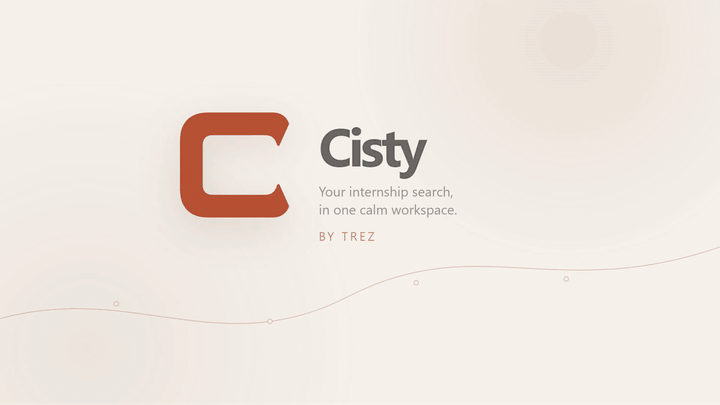

# Cisty

> A private Windows workspace for finding KL internships, comparing nearby MRT/LRT stations, applying through Gmail, and following only the conversations started in Cisty.

[](https://github.com/TrezzyCode/Cisty_Jobapply_centre)
[](https://www.python.org/)

[](https://cdn.jsdelivr.net/gh/TrezzyCode/Cisty_Jobapply_centre@main/docs/media/cisty-promo-no-music.mp4)

**[Watch the 1080p product film — no background music, interface SFX only](https://cdn.jsdelivr.net/gh/TrezzyCode/Cisty_Jobapply_centre@main/docs/media/cisty-promo-no-music.mp4)**

[Download the original MP4 from GitHub](https://raw.githubusercontent.com/TrezzyCode/Cisty_Jobapply_centre/main/docs/media/cisty-promo-no-music.mp4)

## What Cisty does

- Imports a company Excel workbook and matches any existing recruitment-email candidates by company name. Candidates stay unverified until the user checks them.
- Filters companies by industry, region, application status, transit line, and calculated station distance.
- Calculates and saves the nearest supported KL MRT, LRT, or Monorail station so results do not need to be recomputed on every launch.
- Creates reviewed Gmail drafts or sends an application with the selected resume.
- Shows only Gmail conversations created through Cisty. Unrelated inbox and sent mail are never displayed.
- Restores Applied/Replied status and tracked Cisty conversations on another computer through the private `Cisty/Applications` Gmail label.
- Keeps the imported list, profile, API key, resume path, avatar, station cache, and local database on the current Windows account.

Supported lines include MRT Putrajaya, MRT Kajang, LRT Kelana Jaya, LRT Ampang, LRT Sri Petaling, and KL Monorail.

## Run the current version

Requirements: Windows 10/11 and Python 3.10 or newer.

```text
1. Open InternshipAutoApply/
2. Run install.bat once
3. Run run_glass_ui.bat
```

The current interface is built with PySide6. `run_glass_ui.bat` launches it through `pythonw.exe`, so a console selection cannot pause the UI.

## First-time setup

1. Open **My Workspace** and enter your profile information.
2. Select your resume PDF and Google OAuth desktop-app `credentials.json`.
3. Add a free Geoapify key for company-address geocoding. A Google Maps Routes API key is not required.
4. Import the company workbook, verify recruitment contacts, and calculate stations for the industry/region currently selected.
5. Use **Sync Gmail** on another computer after importing the same company list and signing into the same Gmail account.

Detailed setup and safety notes:

- [Application guide](InternshipAutoApply/README.md)
- [Gmail setup](InternshipAutoApply/UserPack/docs/01_GMAIL_SETUP.md)
- [Geoapify setup](InternshipAutoApply/UserPack/docs/02_GEOAPIFY_SETUP.md)
- [User guide](InternshipAutoApply/UserPack/docs/03_SOFTWARE_GUIDE.md)
- [Privacy and safety](InternshipAutoApply/UserPack/docs/04_PRIVACY_AND_SAFETY.md)
- [Troubleshooting](InternshipAutoApply/UserPack/docs/05_TROUBLESHOOTING.md)

## Privacy boundary

Personal data is stored under `%LOCALAPPDATA%\IT Internship Auto Apply` and is excluded from Git:

- imported company database and saved station results;
- Gmail OAuth token and credentials path;
- resume path, API key, avatar, and profile details.

The repository and promotional media contain fictional demonstration data only. Never commit OAuth credentials, Gmail tokens, resumes, API keys, or a personal database.

## Repository layout

```text
InternshipAutoApply/
├─ qt_main.py          Current Cisty interface
├─ main.py             Shared database and legacy fallback
├─ UserPack/           End-user setup and support files
├─ promo/              Reproducible Remotion product-film project
├─ build_exe.bat       Local EXE build script
└─ HANDOFF.md          Architecture and release handoff
```

The latest source is available here; a public prebuilt EXE is not currently attached to this repository. Build locally with `InternshipAutoApply/build_exe.bat` after completing release QA.

---

**Cisty — Apply with clarity.**

by Trez
